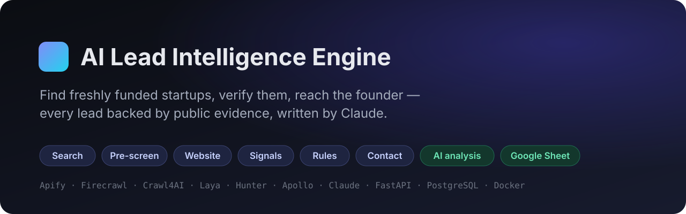
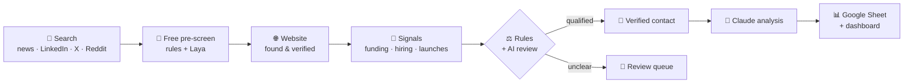
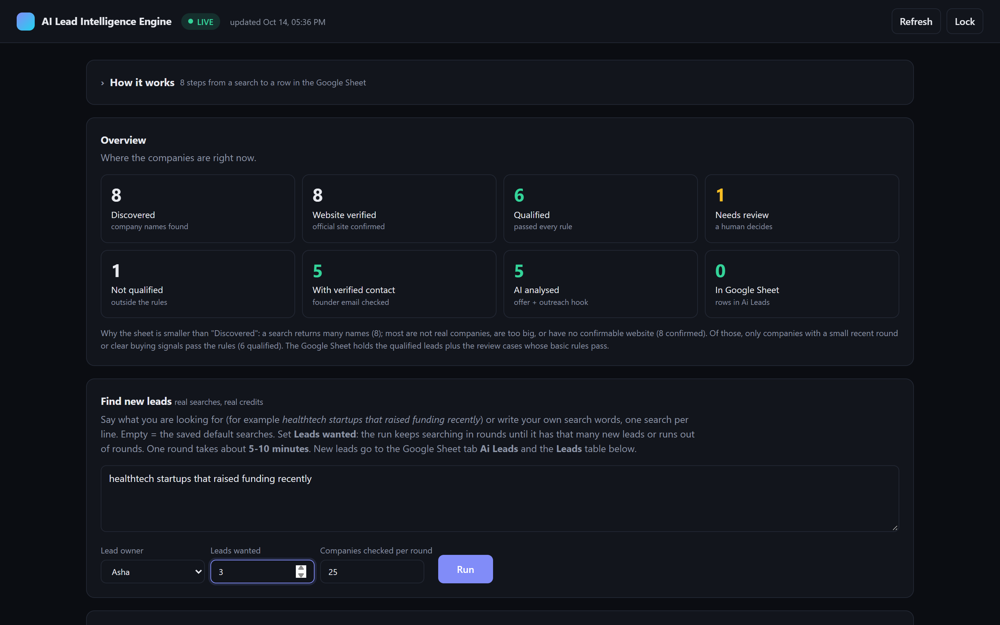
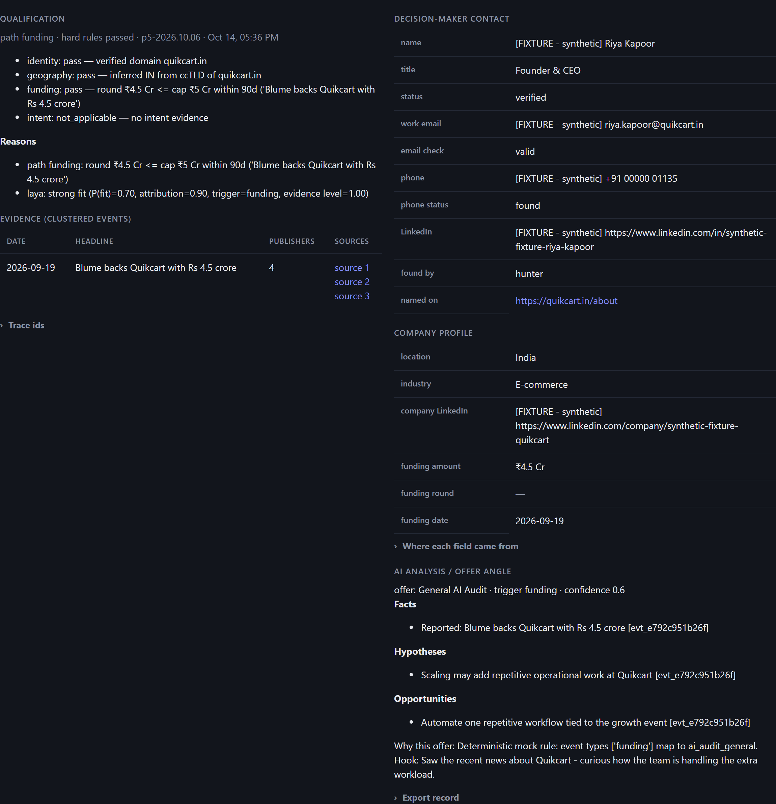
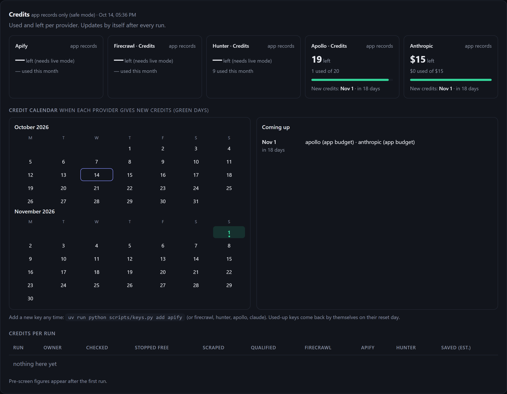
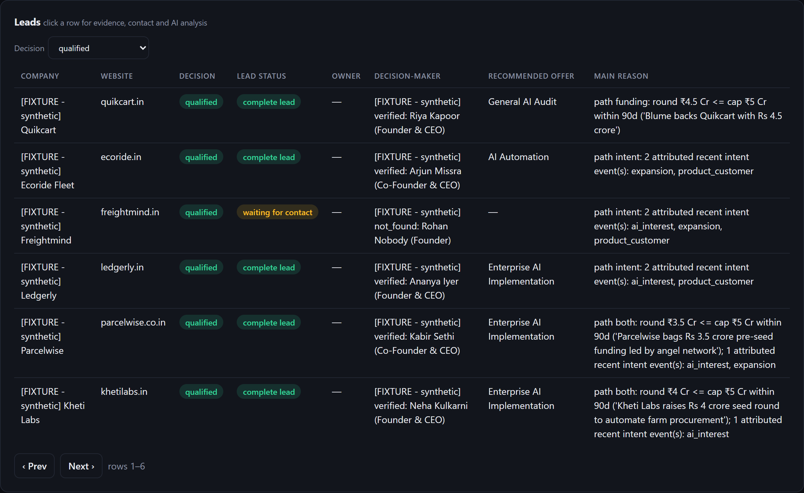

https://github.com/user-attachments/assets/0719d764-caf4-45b2-a5b4-8e2bcee520c2

<div align="center">



<h3>Find young companies that just raised money — and know exactly why they are worth a call.</h3>

[](https://github.com/izeen-ux/ai-lead-intelligence-engine/actions/workflows/ci.yml)
[](LICENSE)


[](CONTRIBUTING.md)

[**Quick start**](#-quick-start) · [**How it works**](#-how-it-works) · [**Screenshots**](#%EF%B8%8F-screenshots) · [**Commands**](#-commands) · [**Contributing**](#-contributing)

</div>

---

<h3 align="center">🎬 1-minute intro</h3>

<p align="center">
  <a href="docs/media/lead-engine-demo.mp4"></a>
</p>
<p align="center"><a href="docs/media/lead-engine-demo.mp4"><b>▶ Watch the full video with sound (1 min)</b></a> · <a href="https://github.com/izeen-ux/ai-lead-intelligence-engine/releases/latest">download from the latest release</a></p>

**AI Lead Intelligence Engine** is a self-hosted B2B lead pipeline. It searches news, LinkedIn, X and Reddit for startups that recently raised a small round or are visibly growing, checks every company against fixed qualification rules, confirms its official website, finds a verified founder e-mail, and asks **Claude** for an evidence-based outreach angle. Results land in a **Google Sheet** and a clean web **dashboard**.

> Every value links back to the public source it came from. Nothing is guessed, and the AI never decides a lead on its own.

## ✨ Features

**🔎 Discovery**
- 6 sources in parallel: Google news, startup news, LinkedIn posts, LinkedIn jobs, X, Reddit — through public [Apify](https://apify.com) Actors (no logins, cookies or CAPTCHA tricks)
- Type what you want in plain English (*"healthtech startups that raised funding recently"*) — it becomes proper search queries
- **Leads wanted**: a run keeps searching in rounds until it has that many new leads
- Claude reads discussion posts and names the companies that pattern matching could not

**✅ Qualification you can trust**
- Free **pre-screen** (rules + local Laya classifier) before any paid scraping — saves credits
- Official website found and verified (Firecrawl, Crawl4AI fallback)
- Hard rules: target country, round-size cap, 90-day window, evidence really about *this* company
- **AI review** for unclear cases; anything still uncertain goes to a human review queue with a full audit trail

**📇 Enrichment & analysis**
- Founder name, verified work e-mail and LinkedIn (Hunter, Apollo, web-search fallback)
- Claude writes facts, pain hypotheses, AI opportunities, the matching offer and an outreach hook — each tied to evidence ids

**📊 Operations**
- Dashboard: overview funnel, Run button with live progress, lead detail with evidence, human review
- **Credit counter** per provider and per run, plus a **credit calendar** showing when each key's credits reset
- **Backup API keys**: a used-up or rejected key switches to the next one automatically
- Safe mode by default — nothing can spend money until you switch it on
- Idempotent Google Sheet export (writes by header name, keeps your own columns)
- Docker Compose deployment, backup/restore, 1,200+ automated tests

## 🧭 How it works



| Step | What happens | Paid? |
|---|---|---|
| 1 Search | Up to 6 sources searched at the same time; queries rotate every round | Apify |
| 2 Pre-screen | Investors, big companies and non-company names stopped | free |
| 3 Website | Official site found, read and confirmed | Firecrawl |
| 4 Signals | Funding / hiring / expansion events clustered across publishers | free |
| 5 Rules | Country, round ≤ cap in 90 days or buying signals, evidence attribution; AI review for unclear cases | Claude (small) |
| 6 Contact | Founder + verified e-mail | Hunter / Apollo |
| 7 Analysis | Offer angle and outreach hook, grounded in evidence | Claude |
| 8 Export | Google Sheet tab + dashboard | free |

## 🖼️ Screenshots

| Overview & Run | Lead detail with evidence |
|---|---|
|  |  |
| **Credits & reset calendar** | **Leads** |
|  |  |

<sub>Screenshots use the built-in demo data (synthetic companies). Intro video: [`docs/media/lead-engine-demo.mp4`](docs/media/lead-engine-demo.mp4) · screen recording: [`docs/media/demo.mp4`](docs/media/demo.mp4) · light theme: [`overview-light.png`](docs/media/overview-light.png).</sub>

## 🚀 Quick start

**Try the dashboard in one minute (sample data, no keys, no cost):**

```bash
git clone https://github.com/izeen-ux/ai-lead-intelligence-engine.git
cd ai-lead-intelligence-engine
uv sync
uv run python scripts/run_dashboard.py --demo --port 8010
```

Open <http://127.0.0.1:8010/dashboard>.

**Run it for real (Docker):**

```bash
cp .env.example .env                        # Windows PowerShell: copy .env.example .env
uv run python scripts/keys.py add apify      # paste each key at a hidden prompt; checked before saving
uv run python scripts/keys.py add firecrawl
uv run python scripts/keys.py add hunter
uv run python scripts/keys.py add claude
docker volume create lead-intel-pgdata
docker compose up -d --build
uv run python scripts/smoke_check.py        # last line: SMOKE CHECK PASSED
uv run python scripts/live_mode.py on       # enables the Run button (spends credits)
uv run python scripts/copy_operator_token.py
```

Open <http://127.0.0.1:8000/dashboard>, paste the token, type what you are looking for and click **Run**.

<details>
<summary><b>Requirements</b></summary>

- [Docker Desktop](https://www.docker.com/products/docker-desktop/) (8 GB free RAM, ~12 GB disk for images and the Laya model)
- [uv](https://docs.astral.sh/uv/) (installs Python 3.13 by itself)
- API keys: Apify, Firecrawl, Hunter (Apollo optional), Anthropic (Claude), and a Google service account for the Sheet — see [docs/providers/PROVIDER_SETUP.md](docs/providers/PROVIDER_SETUP.md) and [docs/GOOGLE_SHEETS_SETUP_GUIDE.md](docs/GOOGLE_SHEETS_SETUP_GUIDE.md)
- In `.env` set `REASONING_PROVIDER=anthropic` to use Claude
</details>

## 🔑 Providers & keys

| Provider | Used for | Free tier | Setting in `.env` |
|---|---|---|---|
| Apify | Discovery Actors (news, LinkedIn, X, Reddit) | ~$5 / month | `APIFY_TOKEN` (+ `APIFY_TOKEN_BACKUPS`) |
| Firecrawl | Website search and scraping | 1,000 credits | `FIRECRAWL_API_KEY` (+ `_BACKUPS`) |
| Hunter | Founder e-mail + verification | 50 searches | `HUNTER_API_KEY` (+ `_BACKUPS`) |
| Apollo | People match (optional) | limited | `APOLLO_API_KEY` (+ `_BACKUPS`) |
| Anthropic | Analysis, AI review, post reading | pay-as-you-go | `ANTHROPIC_API_KEY` |
| Google Sheets | Output tab | free | service-account JSON in `secrets/google/` |

Several keys per provider are supported — `uv run python scripts/keys.py list` shows each key, whether it is accepted, what it has used and **when its credits come back**.

## 🧰 Commands

| I want to | Command |
|---|---|
| Start / stop | `docker compose up -d` · `docker compose stop` |
| Run button on / off | `uv run python scripts/live_mode.py on` · `off` |
| Add / check keys | `uv run python scripts/keys.py add apify` · `list` |
| Health check | `uv run python scripts/smoke_check.py` |
| Pipeline from the terminal | `uv run python scripts/run_pipeline.py --db --live --stages all --limit 15 --prompt "fintech startup raises seed"` |
| Share the dashboard | `cloudflared tunnel --url http://127.0.0.1:8000` |
| Back up the database | `uv run python scripts/backup_db.py` |

Full handbook: [docs/handbook/commands.html](docs/handbook/commands.html).

## ⚙️ Configuration highlights

All settings live in `.env` (every one is documented in [`.env.example`](.env.example)):

| Setting | Default | Meaning |
|---|---|---|
| `REASONING_PROVIDER` | `openai` | `anthropic` = Claude (recommended), `openai`, or `ai_router` |
| `ANTHROPIC_MODEL` | `claude-opus-5-5` | Claude model for analysis and review |
| `DISCOVERY_SOURCES_ENABLED` | `funding_news` | add `startup_news,linkedin_posts,linkedin_jobs,x_posts,reddit` |
| `FUNDING_CAP_INR` | `50000000` | round-size cap (₹5 crore) |
| `LLM_REVIEW_ENABLED` | `false` | AI review of unclear cases |
| `DISCOVERY_LLM_EXTRACTION` | `false` | Claude reads company names out of social posts |
| `PIPELINE_MAX_ROUNDS` | `5` | rounds per "Leads wanted" run |
| `PIPELINE_PARALLEL_SOURCES` / `_COMPANIES` | `4` / `3` | speed (parallel searches / websites) |
| `LEAD_OWNERS` | empty | team members a run can assign leads to |

The offers Claude recommends come from [`app/knowledge/service_catalog.json`](app/knowledge/service_catalog.json) — replace it with your own services.

## 🗂️ Project structure

```
app/
  api/          FastAPI routes (dashboard API, pipeline runs, review)
  domain/       rules, policies, models (qualification, prescreen, outputs ...)
  providers/    adapters: apify, firecrawl, crawl4ai, laya, hunter, apollo, anthropic, openai
  services/     pipeline + stages, credits, review, sheet export, lead analysis
  web/          the dashboard (one HTML file)
scripts/        live_mode, keys, run_pipeline, backup/restore, smoke_check ...
sidecars/       enrichment-kit sidecar (Node.js) for Hunter / Apollo
docker/         Dockerfiles for Laya and the sidecar
tests/          unit + integration tests (pytest)
docs/           runbooks, policies, provider setup, handbook, media
```

## 🛡️ Safety & responsible use

- **Safe mode by default**: provider calls, paid calls and sheet writes are off unless switched on; every stage has its own budget and a run has a cost cap.
- **Public data only**: Actors read public pages; no account credentials, cookies or CAPTCHA bypasses are used.
- **Secrets** stay in `.env` / `secrets/` (git-ignored) and are redacted from logs.
- You are responsible for following each provider's terms and the privacy and anti-spam laws that apply to you (for example GDPR, India's DPDP Act, CAN-SPAM) when you store contact data or send outreach.

## 🧪 Development

```bash
uv sync
uv run pytest                 # integration tests also run when a PostgreSQL test database is available
uv run ruff check . && uv run ruff format --check . && uv run mypy app tests scripts
cd sidecars/enrichment-kit && node setup.mjs && npm test
```

## 🗺️ Roadmap

- [ ] More contact sources to raise the verified-e-mail rate
- [ ] One-click cloud deployment (always-on server instead of a laptop + tunnel)
- [ ] CRM export (HubSpot, Pipedrive)
- [ ] ICP profiles per campaign, editable from the dashboard

## 🤝 Contributing

Issues and pull requests are welcome — see [CONTRIBUTING.md](CONTRIBUTING.md). Please report security problems privately as described in [SECURITY.md](SECURITY.md).

## 📄 License

[MIT](LICENSE). The enrichment sidecar downloads [enrichment-kit](https://github.com/masteranime/enrichment-kit) (MIT) at a pinned commit during setup.

## ⭐ Star history

[](https://star-history.com/#izeen-ux/ai-lead-intelligence-engine&Date)
