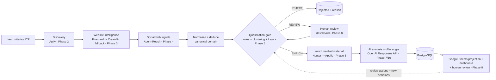
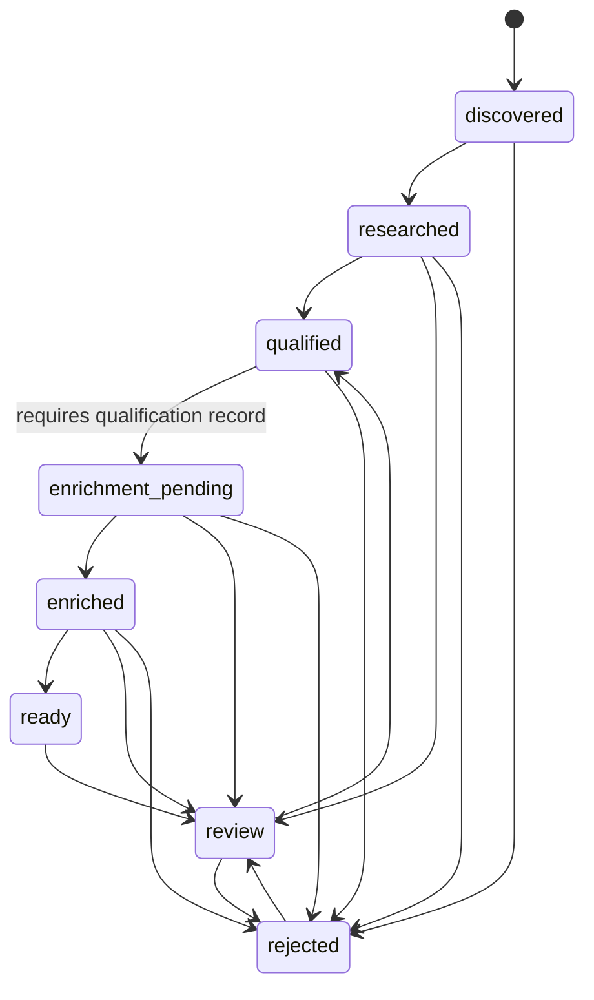

# Architecture

**As of:** final lead-output expansion (2026-10-05) on top of the Phase 10 release candidate.

Lead output (final expansion, ADR-072...076): discovery stage -> one budgeted request per
enabled runnable source (`funding_news`, `startup_news`; ICP query sets, rotation, 90-day date
filter) -> the unchanged stage chain -> `LeadViewService` adds a **company profile** derived
only from stored records (`app/domain/outputs/profile.py`: location, industry, company
LinkedIn, funding) and **field provenance** -> `Leads` layout v2 (old layout converted in
place). Enrichment gained an optional, separately budgeted **phone** capability (default off;
only a number already present in Hunter's email-finder response, never Apollo's paid reveal)
and founder LinkedIn provenance (provider result, or a link on the company's own page; the
LinkedIn site is never fetched). `--limit` is honoured up to `PIPELINE_MAX_COMPANY_LIMIT`.

Orchestration (Phase 9): `scripts/run_pipeline.py` / scheduler / `POST /api/v1/pipeline/runs`
-> `PipelineService` runs the stage services below in order (one run at a time, dry run by
default, fail closed, heartbeat + stale recovery) -> `pipeline_runs`. Stage candidates come from
`SqlPipelineStore` queries that never repeat work or re-decide a human decision (ADR-064).

AI boundary (Phase 10): `ReasoningProvider` -> `OpenAIAdapter` (official SDK, Responses API,
strict JSON-schema output adapted from the domain schema, budgets, typed errors). The
Techno-AI-Router adapter is deprecated and opt-in only (ADR-065...067).

Deployment (Phase 10): Docker Compose - postgres, crawl4ai, laya, enrichment-kit (private
network), a forward-only migrate step, app (FastAPI API + dashboard) and scheduler; non-root
images built from `uv.lock`; loopback-only published ports; operator token on `/api/v1`;
CORS allow-list, body limit, security headers; JSON logs with request id, pipeline run id,
stage and provider (ADR-068...071).

Phase 8 output layer: PostgreSQL remains the system of
record. `scripts/export_leads_to_sheets.py` → `SheetsExportService` (lead views from the stored
Phase 5/6/7 records → pure upsert plan keyed by `lead_id` → `SheetsWriter` = Google Sheets API v4
with a service account, or the in-memory writer) → `export_runs` / `export_items`.
`scripts/run_dashboard.py` → FastAPI `/dashboard` + `/api/v1/*` → `DashboardService` (reads) and
`ReviewService` (approve / reject / reopen = new immutable qualification decisions through the
hard ICP rules + `human_reviews` audit). No provider is called from the output layer except the
Sheets writer (ADR-059…063).

Phase 7 lead analysis flow: `scripts/run_lead_analysis.py` →
`LeadAnalysisService` (re-checks `ensure_enrichment_allowed` + a VERIFIED contact under the same
latest decision → evidence bundle with clustered events and stable ids → budgets →
`ReasoningProvider` = `OpenAIAdapter`, the **single AI boundary**: OpenAI Responses API with a
strict JSON schema, per-run / per-month token and cost budgets, typed errors → strict output +
grounding + catalog validation → insert-only `lead_analyses`). Offers come only from the
versioned `app/knowledge/service_catalog.json` (ADR-054…058).

Phase 6 enrichment flow: `scripts/run_enrichment.py` →
`EnrichmentService` (gate `ensure_enrichment_allowed` incl. ICP-config check → identity from the
company's own pages → PostgreSQL cache → budgets → `EnrichmentOrchestrator` = local Node sidecar
`sidecars/enrichment-kit` (pinned enrichment-kit Waterfall: Hunter → Apollo) → Hunter verification
→ append-only `enrichment_contacts` / `enrichment_attempts`). Hunter/Apollo keys live only in the
sidecar (ADR-047…052). Discovery sources pass the Source Actor Registry (ADR-053); runnable
today: `funding_news` (default) and `startup_news` (approved, off until enabled) - both the
same public Google Search Actor, no login.

Phase 5 (2026-09-30) qualification flow: `scripts/run_qualification.py` →
`QualificationService` (identity + hard ICP rules → event clustering → evidence bundle →
`QualificationProvider` = local Laya sidecar → optional `LlmReviewProvider` for REVIEW only →
policy) → `QualificationStore` (append-only `qualification_runs` / `qualification_decisions`);
Phase 6 must pass `enrichment_gate.ensure_enrichment_allowed` (ADR-039…046).

Phase 4 (2026-09-29) live-capable: Apify discovery (Phase 2), Firecrawl +
Crawl4AI website intelligence (Phase 3), Agent-Reach public signal research (Phase 4: Google News
RSS + YouTube metadata; VERIFIED companies only; ADR-033…038). Research flow:
`scripts/run_signal_research.py` → `SignalResearchService` (gate, budgets, policy re-check) →
`SignalResearchProvider` (`AgentReachAdapter`) → `SignalStore` (`sources` + `signals` +
`signal_research_runs`). Other providers remain offline mocks.

## 1. Target pipeline (built phase by phase)



Core rule: **discover broadly, enrich selectively.** Nothing reaches a paid enrichment provider
without passing the qualification gate; this is enforced in the domain model, not just by
convention (see §4).

## 2. Layers and dependency direction

```
            ┌──────────────┐
  HTTP ───▶ │  app/api     │  routes, deps, error envelope, request-id middleware
            └──────┬───────┘
                   ▼
            ┌──────────────┐
            │ app/services │  orchestration (Phase 1: health + startup checks only)
            └──┬────────┬──┘
               ▼        ▼
   ┌────────────────┐  ┌──────────────────┐
   │ app/providers  │  │ app/repositories │   capability protocols / data access protocols
   │  base.py       │  │  base.py         │
   │  contracts.py  │  └────────┬─────────┘
   │  registry.py   │           ▼
   │  <vendor>/     │     ┌──────────┐
   └───────┬────────┘     │  app/db  │  SQLAlchemy base, lazy session, Alembic
           ▼              └──────────┘
   ┌────────────────┐
   │  app/domain    │  Pydantic models, enums, lifecycle state machine (no I/O, no framework)
   └────────────────┘
            ▲
   app/core (config, logging, errors) is used by every layer.
```

Rules:

1. `app/domain` imports nothing from the app except `app.core.errors`. No I/O.
2. Business/service code depends on **capability protocols** in `app/providers/base.py`, never
   on a vendor class. The only file that names vendor classes is `app/providers/registry.py`.
3. Vendor payloads are translated to `app/providers/contracts.py` DTOs / domain models inside
   the vendor's adapter. Vendor-specific extras go in `raw` / `facts` dicts.
4. Services depend on the `Repository` protocol, not SQLAlchemy.
5. API DTOs (`app/schemas`) are separate from domain models so the public API can evolve
   independently.

## 3. Provider boundary

| Capability protocol | Vendor (registry attribute) | Live phase | Paid | Credential |
|---|---|---|---|---|
| `DiscoveryProvider.discover` | Apify (`discovery`) | 2 ✅ live | yes | `APIFY_TOKEN` |
| `WebsiteIntelligenceProvider.extract_site` + `WebSearchProvider.search_web` | Firecrawl (`website`, `web_search`) | 3 ✅ live | yes | `FIRECRAWL_API_KEY` |
| `WebsiteIntelligenceProvider.extract_site` | Crawl4AI (`website_fallback`) | 3 ✅ live (local) | no | `CRAWL4AI_BASE_URL` + local token |
| `SignalResearchProvider.research` | Agent-Reach (`signal_research`) | 4 ✅ live (public) | no | none (channel allow-list) |
| `QualificationProvider.evaluate` | Laya (`qualification`) | 5 ✅ live (local sidecar) | no | none (loopback `LAYA_ENDPOINT_URL`) |
| `LlmReviewProvider.review` | optional LLM review (`llm_review`) | 5 contract (disabled by default) | yes | none while disabled |
| `EnrichmentOrchestrator.enrich` / `.find_people` | enrichment-kit sidecar (`enrichment`) | 6 ✅ live (local sidecar) | yes* | `ENRICHMENT_KIT_BASE_URL` (loopback) + local token |
| `EnrichmentVendor.enrich` + `EmailVerifier.verify_email` | Hunter via sidecar (`email_vendor`, `email_verifier`) | 6 ✅ live | yes | `HUNTER_API_KEY` (sidecar) |
| `EnrichmentVendor.enrich` | Apollo via sidecar (`people_vendor`) | 6 ✅ live | yes | `APOLLO_API_KEY` (sidecar) |

\* enrichment-kit spends Hunter/Apollo credits, so it is guarded as paid.

Each vendor package has:

- `mock.py` – deterministic offline fake (`PROVIDER_MODE=mock`, the default).
- `adapter.py` – live adapter. Every method first runs `LiveAdapterBase._ensure_callable()`:
  1. **paid guard** – raises `ProviderCallBlockedError` unless `ALLOW_PAID_PROVIDER_CALLS=true`;
  2. **credential check** – raises `ProviderNotConfiguredError` if the key is missing/blank;
  3. Phase 1 only: raises `ProviderNotImplementedError` (the real call lands in its phase).

`status()` on every provider is config-only (never touches the network) and powers
`GET /health/ready`.

## 4. Domain model & invariants

Entities (`app/domain/models.py`): `Company`, `Founder`, `Source`, `Signal` (+`FundingDetails`),
`Qualification` (+`RuleResult`, `LayaOutput`), `Lead` (+`StatusChange`), `EnrichmentResult`,
`PipelineRun` (+`RunError`). All have UUID ids and tz-aware UTC timestamps; unknown fields are
rejected.

Invariants enforced in code:

| Invariant | Where |
|---|---|
| Lead status moves only along allowed transitions; every move is recorded in `status_history` | `lifecycle.py`, `Lead.transition_to` |
| A lead cannot enter `ENRICHMENT_PENDING` without a `qualification_id` | `Lead.transition_to` |
| `ENRICH` decision impossible if any hard rule failed | `Qualification` validator |
| `REVIEW` decision requires a review status | `Qualification` validator |
| Signals must cite ≥ 1 `Source`; confidence ∈ [0,1] | `Signal` |
| Funding details only on `FUNDING` signals; cap check is INR-only (unknown otherwise) | `Signal`, `FundingDetails.within_cap` |
| A discovered email is `UNVERIFIED` until a verifier says otherwise | `EnrichmentResult` default + validator |
| `FAILED` enrichment must carry an error | `EnrichmentResult` validator |
| Domains are canonicalized (`https://www.Acme.io/x` → `acme.io`) for dedupe | `normalize_domain` |

Lead lifecycle:



## 5. Cross-cutting infrastructure

| Concern | Implementation |
|---|---|
| Configuration | `app/core/config.py` – pydantic-settings, env vars / `.env`, secrets as `SecretStr`, cross-field validation (e.g. production requires `DATABASE_URL`, forbids `DEBUG`) |
| Logging | `app/core/logging.py` – stdlib logging, JSON or console, `request_id` on every line, redaction of secret-named keys and known secret values |
| Errors | `app/core/errors.py` – `AppError` taxonomy with `code`, `http_status`, `retryable`; `app/api/errors.py` maps to one JSON envelope; unhandled → generic 500 |
| Health | `GET /health` (liveness), `GET /health/ready` (config, provider mode/credentials, DB) – 503 only when a check is `error` |
| Startup checks | `app/services/startup.py` – logs config summary and warnings (live mode, paid calls enabled, no DB) |
| Database | `app/db` – lazy engine (nothing connects at import), `session_scope`, `check_database`; Alembic reads `DATABASE_URL` from settings; **no tables yet** |
| Network safety | `app/utils/network_guard.py` – blocks non-loopback connects/DNS; autouse in tests and used by the smoke check |

## 6. Runtime

- Entrypoint: `uvicorn app.main:create_app --factory` (app factory; importing modules never reads env).
- Python 3.13 (pinned in `.python-version`; floor `>=3.12`), dependencies locked in `uv.lock`.
